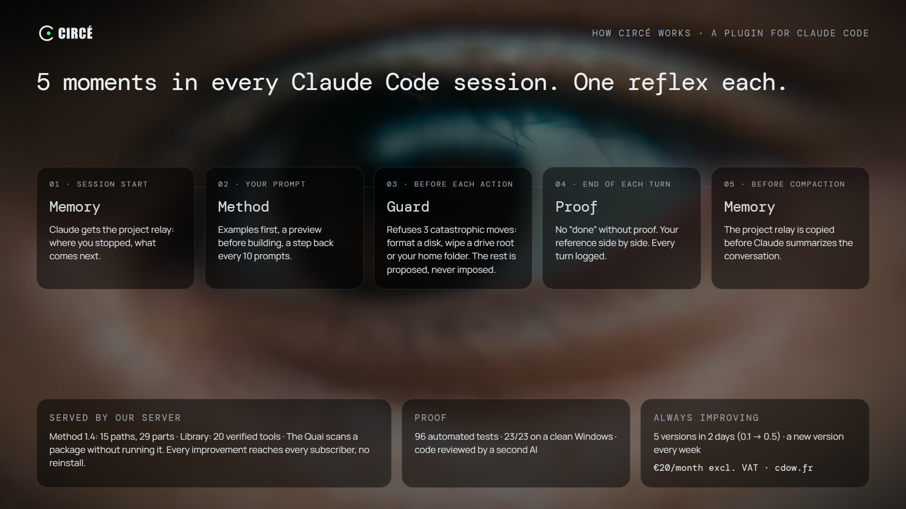
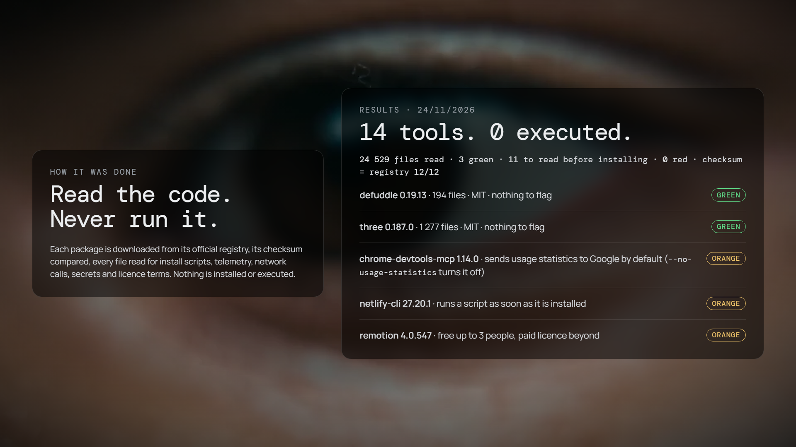

<p align="center"></p>

<p align="center"><b>A living system for Claude Code.</b><br>Memory, method, guard and proof, plus a library of 20 verified tools.</p>

<p align="center"><a href="https://cdow.fr/en/">Website</a> · <a href="https://cdow.fr/en/installation">Install guide</a> · <a href="CHANGELOG.md">Changelog</a> · <a href="FAQ.md">FAQ</a> · <a href="../../issues/new/choose">Support</a></p>

---

## What it does

CIRCÉ is a plugin for Claude Code. It plugs into 5 moments of every session, with one reflex each.



| Moment | Reflex | What happens |
|---|---|---|
| Session start | Memory | Claude gets the project relay: where you stopped and what comes next. |
| Your prompt | Method | Examples first, a preview before building, a step back every 10 prompts. |
| Before each action | Guard | Only 3 catastrophic moves are refused: format a disk, wipe a drive root, wipe your home folder. Everything else is **proposed, never imposed**. |
| End of each turn | Proof | No "done" without proof. Claude is asked to put your reference side by side with the result. Every turn is logged. |
| Before compaction | Memory | The project relay is copied before Claude summarizes the conversation. |

## Served by our server

- **The method.** Version 1.4 has 15 paths in 29 parts. Claude applies it while working, and every improvement reaches every subscriber without reinstalling anything.
- **The library.** It covers what Claude Code can already do, then 20 tools we actually use, grouped by need (site, animation, video, 3D, image). For each one you get the official source, licence, version, installation and known pitfalls.
- **3 signed tools:**
  - **The Quai** reads a package's code (npm, PyPI or GitHub) without ever running it, then gives a green, orange or red verdict.
  - **A motion checker** runs 6 checks on a page.
  - **A public security check** covers e-mail, site and trackers.

What the Quai found in 14 tools on Nov 24, 2026:



## Privacy

Your files, project memory and logs stay on your computer. The server only receives your key, the name of the path or tool you ask for, the version and the language. It never asks for your files or projects. Licences are checked by Gumroad.

## Requirements and price

- Requirements:
  - Claude Code with a paid Claude plan (the free plan is not enough);
  - Python 3.9 or newer;
  - Windows 10/11, macOS or Linux.
- Price: **€20/month excl. VAT**, no minimum term, 3 computers per key, full refund within 14 days. Subscribe on [cdow.fr/en](https://cdow.fr/en/).
- What you produce with CIRCÉ belongs to you, including work for your clients.

## Install

This repository is a Claude Code plugin marketplace. In a terminal (PowerShell, Terminal), with Claude Code installed:

```
claude plugin marketplace add cleobaud/circe
claude plugin install circe@circe-cdow
```

Check with `claude plugin list`: if CIRCÉ shows "disabled", run `claude plugin enable circe@circe-cdow`.
Then open Claude Code in your project and type `/plugin configure circe@circe-cdow` to paste the licence key you received by e-mail after subscribing, choose "Save", and restart Claude Code. Without a key, CIRCÉ stays on standby: the method, the library and the signed tools are served only to subscribers.

**Update:** `claude plugin marketplace update circe-cdow` then `claude plugin update circe@circe-cdow`, and restart Claude Code. Your key is kept; never uninstall to update (uninstalling erases the saved key).

Step-by-step guide with screenshots: [cdow.fr/en/installation](https://cdow.fr/en/installation). The code in this repository is published so that Claude Code can install and update it; its use is governed by the licence in [`circe/LICENCE.txt`](circe/LICENCE.txt).

## How it is tested

- 96 automated tests, and 23/23 checks on a clean Windows sandbox.
- A real-key buyer test: the method is served, the library is read and the signed tools run.
- The 0.5 release was reviewed by a second AI, in 2 rounds.
- Updated regularly: 5 versions shipped in the first 2 days. See the [changelog](CHANGELOG.md).

## Support

Open an issue: [bug](../../issues/new?template=bug.yml), [question](../../issues/new?template=question.yml) or [idea](../../issues/new?template=idea.yml). Never paste your key in an issue.
For anything private (billing, refund): contact@cdow.fr

---

**En français.** CIRCÉ est un plugin pour Claude Code, créé par CDOW. Il agit à 5 moments de chaque session : mémoire, méthode, garde, preuve, et une bibliothèque de 20 outils vérifiés. 20 € HT par mois, sans engagement, remboursement intégral sous 14 jours : [cdow.fr](https://cdow.fr).

<sub>This repository holds the documentation, changelog and support of CIRCÉ. CIRCÉ itself is distributed under licence with a subscription, see the <a href="https://cdow.fr/en/circe-conditions">terms</a>. © CDOW.</sub>
